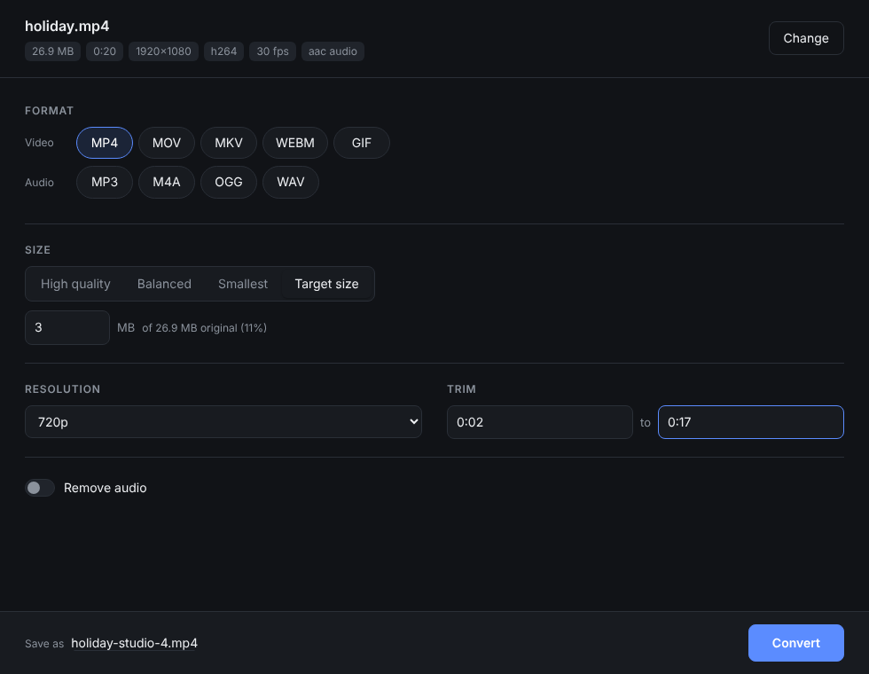

# FFmpeg Studio

A desktop app for changing the format, file size, resolution and length of video and
audio files. It runs [ffmpeg](https://ffmpeg.org) under the hood, and ffmpeg ships
inside the app, so there is nothing else to install.



## What it does

- **Convert** to MP4, MOV, MKV, WebM, animated GIF, MP3, M4A, OGG or WAV.
- **Shrink files** either by picking a quality level (High, Balanced, Smallest) or by
  typing a **target size in MB**. Target size uses a two-pass encode so the result lands
  just under the number you asked for.
- **Resize** to a preset height (4K down to 240p) or a custom one. Width keeps the
  aspect ratio.
- **Trim** by start and end time (`75`, `1:15` or `0:01:15` all work).
- **Remove audio**, or pull just the audio out of a video.
- Shows file details, a **progress bar**, a **Cancel** button, and how much smaller the
  result is. It always writes a new file and never overwrites one unless you pick it by
  clicking the file name next to *Save as*.

## Run it

You need [Node.js](https://nodejs.org) 20 or newer.

```bash
git clone https://github.com/Karan5656/ffmpeg-studio.git
cd ffmpeg-studio
npm install
npm start
```

Drop a file onto the window (or click **Choose file**), pick your settings, and click
**Convert**. The output is saved next to the original as `name-studio.<format>`.

## Build an installer

```bash
npm run dist
```

This uses electron-builder to make a `.dmg` on macOS, an `.exe` installer on Windows or
an `.AppImage` on Linux, in the `dist/` folder. Build on the OS you're targeting.

## Tests

```bash
npm test
```

Unit tests check the ffmpeg arguments for each setting. End-to-end tests generate a
short clip and run the bundled ffmpeg on it for every format, plus resize, trim,
target size and cancel.

## How it's put together

| Path | What it is |
| --- | --- |
| `src/main/main.js` | Electron main process: window, file dialogs, runs conversions |
| `src/main/preload.js` | The small, safe API the UI is allowed to call |
| `src/core/build-jobs.js` | Turns UI settings into ffmpeg arguments (no Electron, easy to test) |
| `src/core/ffmpeg.js` | Runs ffprobe/ffmpeg and reports progress |
| `src/core/formats.js` | Formats, codecs and quality presets |
| `src/renderer/` | The UI (plain HTML, CSS and JavaScript) |

ffmpeg comes from [`ffmpeg-static`](https://www.npmjs.com/package/ffmpeg-static) and
ffprobe from [`ffprobe-static`](https://www.npmjs.com/package/ffprobe-static). Those
ffmpeg builds are GPL-licensed, so keep that in mind if you distribute the app.
